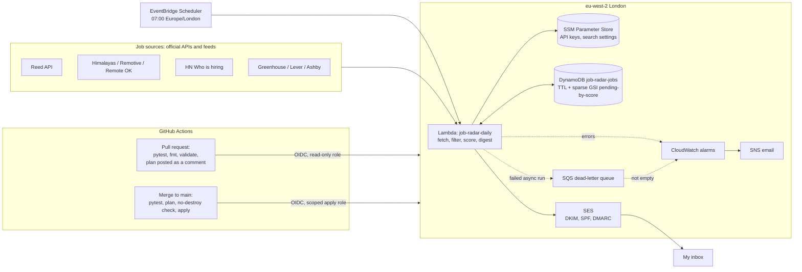

# Job Radar

A serverless system on AWS that searches UK and worldwide-remote job boards every morning, keeps only new roles a UK-based applicant can take, scores each one against my CV, and emails me a ranked digest at 07:00.

Built with Terraform, Python on Lambda, DynamoDB and SES, deployed by GitHub Actions through OIDC (no AWS keys stored anywhere).

  

## What a run does

1. **Fetch** from official sources only: the Reed API (Manchester 40 mi, London 25 mi, Birmingham 25 mi), Himalayas, Remotive and Remote OK for remote roles, the Hacker News "Who is hiring" thread, and company careers feeds (Greenhouse, Lever, Ashby). Adzuna is built in and off by default.
2. **Filter**: drop other job families (Data Engineer, Power Platform, helpdesk...), trainee ads, and pay below £45k a year or £400 a day. Foreign salaries are converted to GBP first.
3. **Check UK eligibility**: every remote job is labelled *eligible*, *unclear* or *not eligible* (US-only wording, other countries, time zones outside UK hours), with the reason kept.
4. **Enrich**: Reed's search API returns a ~450-character snippet, so new Reed jobs get their full ad from the details endpoint before scoring.
5. **Score 0-100 against my CV**: title fit, skills found in the ad (AWS, EKS, Terraform, Argo CD, GitHub Actions...), location, pay and seniority, with penalties for SC/DV clearance, Windows-centred roles and stale ads. Every score keeps its reasons.
6. **Remember**: DynamoDB stores every job, so a job is only "new" once. A fingerprint of company + title catches reposts and the same ad on another board.
7. **Email**: one HTML digest grouped into Top matches, Worth a look and Lower matches. It is sent first and only then are jobs marked as emailed, so a failed send loses nothing.

## Architecture



Email receiving (SES in eu-west-1 to S3 and an ingest Lambda) is also deployed for reading job-alert emails from boards without an API. It is idle for now: I already get LinkedIn and Indeed alerts directly, and parsing them would mostly add duplicates.

## Design decisions

| Decision | Why |
|---|---|
| Lambda + EventBridge Scheduler instead of a server | One run a day; nothing to patch, effectively free |
| DynamoDB with a **sparse GSI** (`digest_pending` + `score`) | Only unsent jobs carry the attribute, so the digest reads exactly the pending jobs, highest score first, with one query |
| TTL on every item | Jobs not seen for 30 days expire on their own; the table cleans itself |
| Fingerprint items in the same table | Cross-board and repost duplicates caught with one batch read, no second table |
| Send, then mark as emailed | A failed send leaves jobs pending for the next run instead of losing them |
| Python standard library + boto3 only | No dependencies to package or patch in Lambda |
| Official APIs only, no scraping, no auto-apply | Respects each board's terms; results stay private and credit the source |
| Separate `bootstrap/` stack for the CI roles | The pipeline can never change its own permissions |

## Security

- **No long-lived credentials.** GitHub Actions gets short-lived AWS credentials through OIDC. The plan role is read-only and only accepts pull-request tokens from this repo; the apply role only accepts `main` and can only manage resources named `job-radar-*`.
- **Trust pinned to immutable IDs.** The roles match GitHub's ID-based subject (`repo:Owner@id/repo@id:...`), so a deleted-and-recreated repo with the same name could not use them.
- **Secrets in SSM SecureString**, created as placeholders by Terraform with `ignore_changes`, so real keys never enter code, Git or Terraform variables.
- **Least-privilege Lambda roles**: one table, one parameter path, KMS decrypt only through SSM, and SES sending only from `radar@jobs.mustaphaseriki.dev`.
- **Sensitive variables** (email addresses) are hidden from plan output and PR comments.
- **Guard rails**: `prevent_destroy` on the jobs table, and both workflows refuse any plan that destroys resources.
- **Untrusted content**: every job ad comes from a third party, so all ad text is HTML-escaped in the digest.

## CI/CD

| Event | Workflow | Steps |
|---|---|---|
| Pull request | `ci.yml` | pytest -> `terraform fmt -check` -> `validate` -> `plan` (read-only, no state lock) -> plan posted as a PR comment -> fail if anything would be destroyed |
| Merge to `main` | `deploy.yml` | pytest -> plan -> refuse-to-destroy check -> `apply` (one deploy at a time, never cancelled midway) |

## Problems I hit and how I fixed them

- **The digest vanished in Outlook.** SES reported a successful delivery with no bounce, yet nothing arrived. The domain had DKIM but no DMARC record, and SPF was checked against `amazonses.com`. I added a DMARC record and a custom MAIL FROM (`bounce.jobs...`), so SPF, DKIM and DMARC all align with my domain; a small test and the full digest then landed in the inbox.
- **OIDC `Not authorized to perform sts:AssumeRoleWithWebIdentity`.** The trust policy expected `repo:Kingmanne/job-radar:pull_request`. CloudTrail showed GitHub now sends an ID-based subject (`repo:Kingmanne@173724415/job-radar@1450656179:pull_request`). I updated the trust to accept it, which is also more secure.
- **Reed jobs ranked unfairly low.** Search results only include a snippet, so remote boards with full ads matched more skills. Fetching the full ad for new Reed jobs (capped, with a pause between calls) moved strong Manchester roles from 74 to 88.
- **Remotive returned writers and sales jobs.** The `devops` category name did not match theirs, so the API silently returned an unfiltered sample. Now the whole feed is fetched in one call and filtered locally.
- **Time-zone ranges dropped good remote jobs.** "UTC-8 to UTC+2" was read as UTC-8 only. Ranges that include UK time now count as *unclear* instead of *not eligible*.
- **Switching DynamoDB to `key_schema` without risk.** The deprecation only affected the index, not the table key. I added `prevent_destroy` first and only merged once the plan showed no change to the table.

## Running it

```bash
# tests (no AWS or network needed)
python -m venv .venv && source .venv/bin/activate
pip install -r requirements-dev.txt
python -m pytest -q

# see what today's run would find, writing nothing
PYTHONPATH=src python -m jobradar.fetch --dry-run --show-dropped
TABLE_NAME=job-radar-jobs PYTHONPATH=src python -m jobradar.daily --dry-run

# preview the email from what is pending
PYTHONPATH=src python -m jobradar.digest --preview /tmp/digest.html

# run in AWS now
aws lambda invoke --function-name job-radar-daily --cli-read-timeout 310 /tmp/out.json   # full run
aws lambda invoke --function-name job-radar-daily --cli-binary-format raw-in-base64-out \
  --payload '{"digest_only": true}' /tmp/out.json                                         # email only
```

### First-time setup

1. `cd bootstrap && terraform apply` once, to create the GitHub OIDC roles.
2. In the repo settings, add `AWS_PLAN_ROLE_ARN` and `AWS_APPLY_ROLE_ARN` as Actions **variables**, and `terraform.tfvars` as the `TF_VARS` **secret**.
3. Merge to `main` (or `cd terraform && terraform apply` the first time).
4. Add the DNS records from `terraform output cloudflare_dns_records`, plus the DMARC and MAIL FROM records described above.
5. Confirm the AWS emails (SES recipient, SNS alarm subscriptions) and store the API keys with the commands in `terraform output set_api_keys`.

## Repository layout

```
src/jobradar/
  sources/        reed, adzuna, himalayas, remotive, remoteok, hn, ats (Greenhouse/Lever/Ashby)
  fetch.py        run every source, filter, dedupe within the run
  eligibility.py  UK eligibility rules
  money.py        GBP conversion, salary text parsing
  scoring.py      CV scoring with reasons
  store.py        DynamoDB storage and cross-board dedupe
  digest.py       HTML/text email via SES
  daily.py        Lambda handler and local CLI
tests/            76 pytest tests with recorded API fixtures
terraform/        the pipeline (two regions)
bootstrap/        GitHub OIDC roles (applied once, by hand)
.github/workflows ci.yml, deploy.yml
```

## Data and terms

Results are for my own use and are never republished. Jobs from Himalayas, Remotive and Remote OK link to the original listing and credit the board, as their API terms ask.
